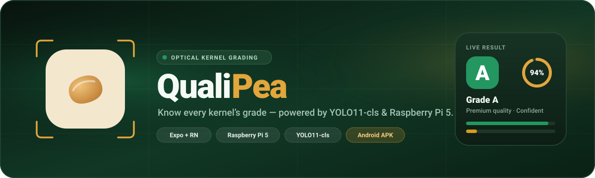
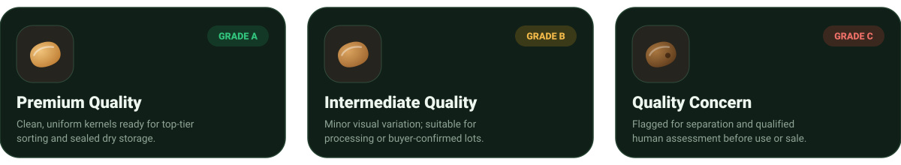
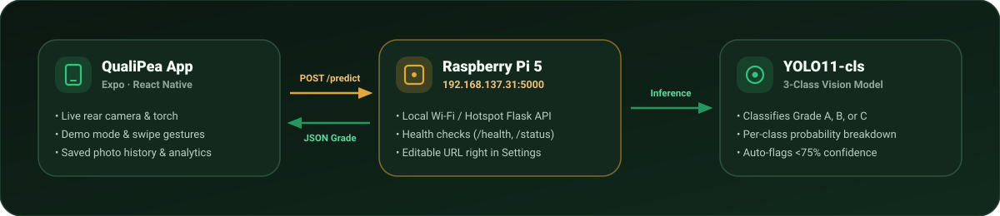

<div align="center">



<br/><br/>

[](https://expo.dev)
[](https://reactnative.dev)
[](#-raspberry-pi-5-integration)
[](#-building-the-android-apk)

<br/>

[Grading Tiers](#-grading-tiers) • [Features](#-features) • [Architecture](#-architecture) • [Raspberry Pi 5 API](#-raspberry-pi-5-integration) • [Getting Started](#-getting-started) • [Build APK](#-building-the-android-apk)

</div>

---

## 🥜 Grading Tiers



---

## ✨ Features

| Area | Highlights |
| :--- | :--- |
| **Interactive Launch** | Editorial dark-emerald Splash screen with a bouncing swipe-up arrow track + 4-step Onboarding flow |
| **Live Camera & Demo Mode** | Switch between the **Demo Pi 5 Chamber** and **Real Rear Camera** (`expo-camera`) with torch/flash control |
| **Raspberry Pi 5 Sync** | Connects to your local Pi 5 Flask server (`http://192.168.137.31:5000`), editable directly in **Settings** |
| **Classification Result** | Animated grade badge, SVG progress confidence ring, captured photo preview, probability bars, Price & Advice tabs |
| **History & Expert Override** | Filter by `All`, `Grade A/B/C`, or `Flagged`; tap any scan to view the centered kernel photo and apply non-destructive expert corrections |
| **Dashboard Analytics** | Total scan distribution, average confidence, Grade A rate, review queue, and animated 7-day activity chart |
| **Gestures & Preferences** | Swipe left/right across tabs, swipe down to dismiss bottom sheets, edge-swipe back on sub-screens, and toggles for **Animations**, **Sound**, **Demo mode**, and **Dark mode** |

---

## 🧭 Architecture



---

## 🍓 Raspberry Pi 5 Integration

When **Demo mode** is turned **OFF** in **Settings**, QualiPea communicates directly with your Raspberry Pi 5 server over local Wi-Fi or hotspot.

- **Default Server URL:** `http://192.168.137.31:5000` *(editable anytime in **Settings → Raspberry Pi 5 server URL**)*
- **Health Endpoints:** `GET /health` → fallback `/status` → fallback `/`
- **Classification Endpoint:** `POST /predict` *(fallback `/classify`, `/grade`)* with `multipart/form-data` (`file` / `image`)

```json
{
  "grade": "A",
  "confidence": 0.94,
  "model": "yolo11n-cls 1.0.0",
  "probabilities": {
    "A": 0.94,
    "B": 0.04,
    "C": 0.02
  }
}
```

> Both Android (`usesCleartextTraffic: true`) and iOS (`NSAllowsArbitraryLoads: true`) are preconfigured in [app.json](app.json) so local `http://` LAN requests work cleanly in standalone builds.

---

## 📁 Project Structure

```text
qualipea-expo/
├── App.jsx                    # Root entry wrapping AppProvider and Navigator
├── app.json                   # Expo manifest, camera/audio permissions & EAS config
├── eas.json                   # EAS Build profiles (Android APK)
├── assets/
│   ├── readme/                # Custom vector SVGs for README documentation
│   └── sounds/                # Custom WAV audio cues (boot, shutter, nav, grades)
└── src/
    ├── api.js                 # Raspberry Pi 5 HTTP health & classification client
    ├── AppContext.jsx         # Global state, Pi 5 sync, animations & audio toggles
    ├── Navigator.jsx          # Screen router with directional transitions & gestures
    ├── theme.js               # Light/dark palettes, grade colors & AnimCtx
    ├── data.js                # Grade definitions, handling advice & sample scans
    ├── sound.js               # Audio playback engine
    ├── components/            # TabBar, SheetModal, Kernel SVG, Ring, Bar, Card, Btn
    └── screens/               # Splash, Onboarding, Home, ScanPrep, Scanner,
                               # Processing, Result, History, Dashboard, Settings
```

---

## 🛠️ Getting Started

```bash
# 1. Install dependencies
npm install

# 2. Start the Expo dev server
npx expo start
```

Scan the QR code with **Expo Go** (or press `a` for Android emulator / `w` for web).

---

## 📦 Building the Android APK

QualiPea is preconfigured with [eas.json](eas.json) to build an installable standalone Android `.apk` via **EAS Build**:

```bash
npx eas-cli login
npx eas-cli build -p android --profile preview
```

Once the cloud build finishes, open the EAS build URL to download or QR-install the `.apk` directly onto any Android device.

---

<div align="center">

<sub>Built with 🥜 for smarter Spanish peanut quality grading.</sub>

</div>
